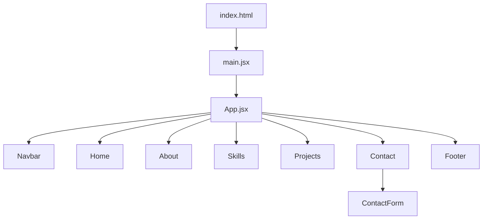

# Design Document

## Feature: portfolio-react-conversion

---

## Overview

This design describes the conversion of Mahlet Chanyalew's static HTML/CSS portfolio into a Vite + React single-page application. The goal is a **functionally equivalent** output: every pixel, animation, hover effect, and responsive breakpoint from the original site is preserved, while the codebase is reorganised into focused, independently maintainable React components.

The conversion is a **structural refactor**, not a redesign. No new visual features are introduced. The primary technical changes are:

- Replacing vanilla-JS DOM manipulation with React `useState` hooks for the hamburger menu and contact-form submission state.
- Splitting the monolithic `home.html` into seven co-located component files.
- Replacing the `<form action="submit.html">` server navigation with a client-side success message rendered by React state.

---

## Architecture

The application is a client-side SPA with no backend. Vite serves as the build tool and dev server.

```
portfolio-react-conversion/
├── index.html                  ← Font Awesome kit, Google Fonts links, root div
├── vite.config.js
├── package.json
└── src/
    ├── main.jsx                ← ReactDOM.createRoot entry point
    ├── App.jsx                 ← Composes all section components in order
    ├── index.css               ← Global reset, body, html, .container styles
    └── components/
        ├── Navbar/
        │   ├── Navbar.jsx
        │   └── Navbar.css
        ├── Home/
        │   ├── Home.jsx
        │   └── Home.css
        ├── About/
        │   ├── About.jsx
        │   └── About.css
        ├── Skills/
        │   ├── Skills.jsx
        │   └── Skills.css
        ├── Projects/
        │   ├── Projects.jsx
        │   └── Projects.css
        ├── Contact/
        │   ├── Contact.jsx
        │   ├── Contact.css
        │   └── ContactForm.jsx
        └── Footer/
            ├── Footer.jsx
            └── Footer.css
```

### Data flow



All state is **local** to the component that owns it:

| Component | State | Hook |
|-----------|-------|------|
| `Navbar` | `menuOpen: boolean` | `useState(false)` |
| `ContactForm` | `name, email, message: string`; `submitted: boolean` | `useState` |

No global state management (Redux, Context) is needed.

---

## Components and Interfaces

### `App.jsx`

Renders all seven section components in document order. No props, no state.

```jsx
function App() {
  return (
    <>
      <Navbar />
      <Home />
      <About />
      <Skills />
      <Projects />
      <Contact />
      <Footer />
    </>
  )
}
```

---

### `Navbar`

**Props:** none  
**State:** `menuOpen: boolean`

Responsibilities:
- Render fixed nav bar with logo and link list.
- Toggle `menuOpen` on hamburger click → applies `active` CSS class to both `<ul>` and the toggle `<div>`.
- Close menu when any nav link is clicked.
- Expose `aria-label="Toggle navigation"` and `aria-expanded={menuOpen}` on the toggle button.

```jsx
const [menuOpen, setMenuOpen] = useState(false);

const toggleMenu = () => setMenuOpen(prev => !prev);
const closeMenu = () => setMenuOpen(false);
```

The `active` class is applied conditionally:

```jsx
<div
  className={`nav-toggle${menuOpen ? ' active' : ''}`}
  onClick={toggleMenu}
  aria-label="Toggle navigation"
  aria-expanded={menuOpen}
  role="button"
  tabIndex={0}
>
```

---

### `Home`

**Props:** none  
**State:** none

Renders the `<header id="header">` element. Contains the `.hero` sub-section with text content on the left and the circular profile image on the right. The `float` and `fadeIn` CSS animations are applied via class names — no JS required.

Image import:

```jsx
import profileImg from '../assets/pic 2.jpg';
```

---

### `About`

**Props:** none  
**State:** none

Renders `<section id="about">`. Mirrors the original layout: image left, text right (stacks on ≤992 px). The `float` animation on the image is CSS-only.

---

### `Skills`

**Props:** none  
**State:** none

Renders `<section id="skills">`. The three skill cards are driven by a static data array to avoid repetition:

```js
const skillCategories = [
  {
    title: 'Technical Skills',
    items: ['HTML', 'CSS', 'JavaScript', 'React', 'Responsive Design'],
  },
  {
    title: 'Experience',
    items: [
      'Creating websites for Hotels',
      'Developing portfolio websites',
      'Company website development',
    ],
  },
  {
    title: 'Education',
    items: [
      'Software Engineering at Wollo University',
      'Andalus Coding Academy',
      'Udacity Online Courses',
    ],
  },
];
```

The staggered hover reveal is handled entirely by CSS `transition-delay` on `.skill-item:nth-child(n)` — no JS needed.

---

### `Projects`

**Props:** none  
**State:** none

Renders `<section id="projects">`. Three project cards are driven by a static data array:

```js
const projects = [
  {
    image: phoneImg,
    alt: 'Hotel Website Project',
    title: 'Website Development For Hotels',
    description: 'Creating a Website for Hotels and Restaurants...',
  },
  // ...
];
```

The hover overlay slide-up and image scale are CSS-only (`.work:hover .layer`, `.work:hover img`).

---

### `Contact`

**Props:** none  
**State:** none (delegates form state to `ContactForm`)

Renders `<section id="contacts">`. Composes the left column (contact info + social links) and the right column (`<ContactForm />`).

Social links are driven by a static array:

```js
const socialLinks = [
  { href: 'https://t.me/Hemennnnnn', icon: 'fa fa-telegram', label: 'Telegram' },
  { href: 'https://www.instagram.com/hema.chh/', icon: 'fa fa-instagram', label: 'Instagram' },
  { href: 'https://www.linkedin.com/in/mahlet-chanyalew-8301b9358...', icon: 'fa fa-linkedin', label: 'LinkedIn' },
  { href: 'https://github.com/Mahlett2', icon: 'fa fa-github', label: 'GitHub' },
];
```

---

### `ContactForm`

**Props:** none  
**State:** `name`, `email`, `message` (strings), `submitted` (boolean)

When `submitted` is `true`, the form is replaced by a success message `<div>`. The `onSubmit` handler calls `e.preventDefault()` and sets `submitted` to `true`.

```jsx
const handleSubmit = (e) => {
  e.preventDefault();
  setSubmitted(true);
};

if (submitted) {
  return <div className="success-message">Thank you! Your message has been sent.</div>;
}
```

---

### `Footer`

**Props:** none  
**State:** none

Renders `<footer>` with the copyright text. Styled via `Footer.css` (extracted from the bottom of `contact.css`).

---

## Data Models

There are no server-side data models. All content is static and co-located with the components that render it.

### `SkillCategory`

```ts
interface SkillCategory {
  title: string;       // e.g. "Technical Skills"
  items: string[];     // e.g. ["HTML", "CSS", ...]
}
```

### `Project`

```ts
interface Project {
  image: string;       // imported asset URL
  alt: string;         // accessible alt text
  title: string;
  description: string;
}
```

### `SocialLink`

```ts
interface SocialLink {
  href: string;        // full URL
  icon: string;        // Font Awesome class string, e.g. "fa fa-github"
  label: string;       // aria-label value, e.g. "GitHub"
}
```

### `ContactFormState`

```ts
interface ContactFormState {
  name: string;
  email: string;
  message: string;
  submitted: boolean;
}
```

---

## CSS Strategy

Each component imports its own CSS file. Global styles (reset, `body`, `html`, `.container`) live in `src/index.css` and are imported once in `main.jsx`.

The original CSS class names are preserved **exactly** to avoid any visual regression. The only additions are:

- `.success-message` — new class for the post-submission confirmation in `Contact.css`.
- `Footer.css` — extracts the `footer` rule from `contact.css` into its own file.

Font Awesome is loaded via the kit `<script>` tag in `index.html` (CDN, not npm). Google Fonts are loaded via `<link>` tags in `index.html`. Neither is imported through the JS module graph.

---

## Error Handling

| Scenario | Handling |
|----------|----------|
| Contact form submitted with empty required fields | Browser native `required` validation prevents submission |
| Contact form submitted with invalid email | Browser native `type="email"` validation |
| Image asset not found | Vite build will fail at compile time — caught during development |
| Font Awesome CDN unavailable | Icons degrade gracefully (no layout shift; text links remain functional) |
| Google Fonts CDN unavailable | Browser falls back to `serif` as specified in `font-family` stack |

There is no async data fetching, so no loading/error states are needed beyond the contact form submission.

---

## Testing Strategy

This feature is a structural refactor of a static site. The primary correctness concerns are:

1. **Component rendering** — each component renders the correct HTML structure and content.
2. **Interactive state** — `Navbar` hamburger toggle and `ContactForm` submission state behave correctly.
3. **CSS class application** — active/inactive states apply the right class names.

### Unit / Component Tests (Vitest + React Testing Library)

- Render each component and assert key elements are present (headings, images with correct `alt`, links with correct `href`).
- `Navbar`: assert menu is hidden by default; assert `active` class toggled on hamburger click; assert menu closes on nav-link click; assert `aria-expanded` reflects state.
- `ContactForm`: assert form renders initially; assert success message renders after submit; assert form fields are controlled (value reflects state).
- `Skills`: assert all three category titles and all skill items are rendered.
- `Projects`: assert all three project titles and images are rendered.

### Property-Based Tests

See Correctness Properties section below.

### Visual / Manual Verification

- Run `npm run dev` and visually compare against the original `home.html` at 1280px, 992px, 768px, and 480px viewports.
- Verify `float` animation on both profile images.
- Verify `fadeIn` animation on the Home heading.
- Verify project card hover overlay.
- Verify skill card staggered hover reveal.
- Verify hamburger menu open/close on a mobile viewport.

---

## Correctness Properties

*A property is a characteristic or behavior that should hold true across all valid executions of a system — essentially, a formal statement about what the system should do. Properties serve as the bridge between human-readable specifications and machine-verifiable correctness guarantees.*

The following properties were derived from the acceptance criteria. Infrastructure checks (Vite scaffolding, CSS animations, responsive breakpoints) are not amenable to property-based testing and are covered by smoke tests and visual verification instead. The properties below focus on the interactive state logic and universal structural invariants.

Property-based tests use **fast-check** (JavaScript PBT library). Each test runs a minimum of 100 iterations.

---

### Property 1: Hamburger toggle synchronises CSS class and ARIA state

*For any* sequence of hamburger toggle clicks, the `active` CSS class on both the menu element and the toggle button, and the `aria-expanded` attribute on the toggle button, SHALL always accurately reflect whether the menu is currently open — toggling consistently between open and closed on each click.

**Validates: Requirements 3.5, 11.2**

---

### Property 2: Clicking any nav link closes the menu

*For any* nav link in the navigation menu (Home, About Me, Skills, Projects, Contacts), clicking that link while the menu is open SHALL result in the menu being closed (the `active` class removed from both the menu and the toggle button).

**Validates: Requirements 3.6**

---

### Property 3: Contact form submission shows success message for any valid input

*For any* non-empty name string, valid email string, and non-empty message string, submitting the contact form with those values SHALL prevent default browser navigation and replace the form with a success message element, with the form itself no longer present in the DOM.

**Validates: Requirements 8.7**

---

### Property 4: Every project card image has a non-empty alt attribute

*For any* rendered project card in the Projects section, the `` element within that card SHALL have an `alt` attribute that is a non-empty string.

**Validates: Requirements 11.5**

---

### Property 5: Every social media link has a non-empty aria-label

*For any* social media icon link rendered in the Contact section, the `<a>` element SHALL have an `aria-label` attribute that is a non-empty string naming the platform.

**Validates: Requirements 11.6**
